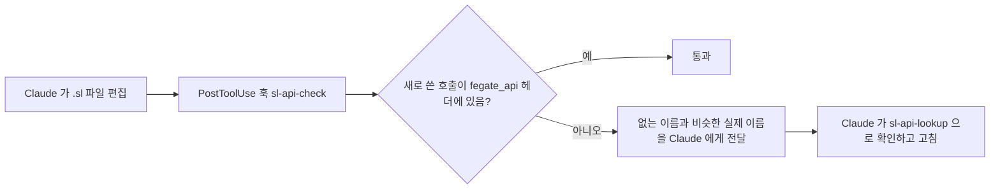

# SVD-Harness

FEGate SL 스크립트 작업용 Claude Code 기초 하네스입니다. AI 가 FEGate API 를 쓸 때 `fegate_api` 헤더에 있는 함수만 쓰도록 하고, 팀의 커밋 규칙과 이름 규칙을 지키게 합니다.

## 구성

| 경로 | 종류 | 역할 |
|---|---|---|
| `rules/commit-convention.md` | 룰 | 커밋 메시지 형식(`말머리: 제목`) |
| `rules/sl-naming.md` | 룰(.sl 파일에만 적용) | API 이름 형태와 새 코드의 이름 규칙. 실제 헤더와 예제에서 센 값이 근거입니다 |
| `rules/sl-api-grounding.md` | 룰(.sl, `fegate_api` 에만 적용) | API 조회 순서, 쓰기 전 확인, 구현 후 확인 |
| `skills/sl-api-lookup/` | 스킬 | 헤더에서 선언 블록과 예제 경로만 뽑는 스크립트(`Find-SlApi.ps1`) |
| `skills/sl-report-fail/` | 스킬 | 함정 원장(`failures.md`)과 기록 절차 |
| `hooks/sl-api-check.ps1` | 훅(PostToolUse) | .sl 편집 직후 헤더에 없는 API 호출을 Claude 에게 알립니다 |
| `templates/CLAUDE.md` | 템플릿 | SL 프로젝트 루트용 CLAUDE.md |
| `settings.template.json` | 설정 | 훅 등록 내용 |
| `tests/` | 테스트 | Pester 테스트 |

룰은 Claude 에게 하는 부탁입니다. 모델이 놓칠 수 있습니다. 훅은 모델 판단과 상관없이 매번 실행됩니다. 그래서 "헤더에 없는 함수 금지" 는 룰로 알리고 훅으로 한 번 더 확인합니다.



## 요구 사항

- Windows 와 Windows PowerShell 5.1 이상. Windows 에 기본으로 들어 있습니다.
- Claude Code
- SL 프로젝트 루트나 그 상위 폴더에 `fegate_api/` 와 `fegate_api_exam/` 이 있어야 합니다. 훅과 조회 스크립트는 편집 중인 파일에서 위로 올라가며 `fegate_api/` 를 찾습니다.

## 설치

1. 저장소를 클론합니다. 클론한 폴더가 설치 원본이므로 지우거나 옮기지 않습니다.

```bash
git clone https://github.com/evespimrose/SVD-Harness.git
```

2. 클론한 폴더에서 설치 스크립트를 실행합니다.

```bash
powershell -NoProfile -ExecutionPolicy Bypass -File .\install.ps1
```

3. 질문 두 개에 답합니다.
   - 첫 번째 질문: `1` 글로벌 또는 `2` 로컬
   - 두 번째 질문(로컬일 때만): 설치할 폴더 경로. 그 폴더의 `.claude` 에 설치됩니다.
4. Claude Code 를 다시 시작합니다.

| 항목 | 글로벌 | 로컬 |
|---|---|---|
| 설치 위치 | `%USERPROFILE%\.claude` | `<지정한 폴더>\.claude` |
| 적용 범위 | 이 PC 에서 연 모든 프로젝트 | 지정한 폴더에서 연 Claude Code |
| 훅 등록 파일 | `settings.json` | `settings.local.json` |
| CLAUDE.md | 만들지 않음 | `<지정한 폴더>\CLAUDE.md` 가 없으면 템플릿을 복사함 |

로컬 설치는 훅 명령에 이 PC 의 클론 경로가 들어갑니다. 그래서 팀이 커밋하는 `settings.json` 이 아니라 개인용 `settings.local.json` 에 씁니다. 같은 이유로 `.claude/rules/svd-harness` 와 `.claude/skills/sl-*` 는 프로젝트의 `.gitignore` 에 넣습니다. 팀원은 각자 설치합니다.

질문 없이 실행하려면 매개변수를 줍니다.

```bash
powershell -NoProfile -ExecutionPolicy Bypass -File .\install.ps1 -Scope Local -Path D:\Work\MySlProject
```

| 매개변수 | 뜻 |
|---|---|
| `-Scope Global` 또는 `-Scope Local` | 첫 번째 질문의 답 |
| `-Path <폴더>` | 두 번째 질문의 답(로컬일 때) |
| `-ClaudeHome <폴더>` | 글로벌 설치 위치. 기본값은 `%USERPROFILE%\.claude` |
| `-Uninstall` | 제거 |
| `-WhatIf` | 바꿀 내용만 보여 주고 아무것도 바꾸지 않음 |

## 설치가 바꾸는 것

1. `rules\svd-harness` 와 `skills\sl-api-lookup`, `skills\sl-report-fail` 을 클론 폴더로 연결하는 junction 을 만듭니다.
2. 같은 이름의 폴더나 파일이 이미 있으면 지우지 않고 `<이름>.backup-<날짜-시각>` 으로 옮긴 뒤 연결합니다.
3. 설정 파일에 훅 항목을 더합니다. 다른 설정과 다른 훅은 그대로 둡니다. 바꾸기 전에 `<설정 파일>.backup-<날짜-시각>` 으로 백업합니다.
4. 로컬 설치이고 `CLAUDE.md` 가 없으면 템플릿을 복사합니다. 이미 있으면 그대로 둡니다.

`rules` 와 `skills` 안에 생긴 백업 폴더는 Claude Code 가 함께 읽습니다. 설치가 끝나면 남은 백업 경로를 출력하므로, 내용을 확인한 뒤 옮기거나 지웁니다.

## 갱신과 제거

- 갱신: 클론 폴더에서 `git pull` 을 실행합니다. 룰, 스킬, 훅 스크립트는 junction 과 절대 경로로 연결되어 있어 바로 적용됩니다. `settings.template.json` 이 바뀌었거나 클론 폴더를 옮겼을 때만 `install.ps1` 을 다시 실행합니다.
- 제거: `install.ps1 -Uninstall` 을 실행합니다. 같은 질문 두 개를 묻습니다. 이 클론을 가리키는 junction 과 이 하네스의 훅 항목만 지웁니다. `CLAUDE.md` 와 백업은 지우지 않습니다.

## 함정 원장 공유

`skills/sl-report-fail/failures.md` 는 클론 폴더 안에 있습니다. Claude 가 새 함정을 기록하면 클론 폴더의 파일이 바뀝니다. 팀이 함께 쓰려면 이 저장소에 커밋하고 푸시합니다. 다른 팀원은 `git pull` 로 받습니다.

## 테스트

Windows 에 내장된 Pester 3.4 로 실행합니다.

```bash
powershell -NoProfile -ExecutionPolicy Bypass -Command "Import-Module Pester -RequiredVersion 3.4.0; Invoke-Pester .\tests"
```

테스트는 임시 폴더에만 설치합니다. 실제 `%USERPROFILE%\.claude` 는 건드리지 않습니다.

## 한계

- 훅은 두 형태만 검사합니다. 하나는 `네임스페이스::함수(` 호출이고, 다른 하나는 API 계열 접두사(`ary`, `str`, `xut` 등) + 대문자로 시작하는 자유 함수 호출입니다. 인자 개수와 타입은 검사하지 않습니다.
- 훅 자체가 실패하면(입력 형식 오류, 스킬 폴더 삭제 등) 편집은 막지 않고 `[sl-api-check] 검사하지 못하고 넘어감` 메시지를 보여 줍니다.
- `#include` 하지 않은 다른 파일에 정의한 사용자 함수가 API 형태 이름이면 훅이 알립니다. 이 경우 Claude 가 정의 위치를 근거로 대고 넘어갑니다. 사용자 함수에는 snake_case 를 씁니다(`rules/sl-naming.md`).
- 헤더 대조는 첫 시도의 정확도를 높입니다. 실행 결과를 보장하지는 않습니다. 실제 동작은 FEGate 에서 확인합니다.
- 개발 중에 `fegate_api_exam` 예제 .sl 542개 전체에 훅 판정을 돌렸습니다. 알림은 1건이었습니다. `trans/FileIO/EX_CombinedExport.sl` 의 `fileIO::ExportModelFile` 이고, 헤더에는 `fileIO::ExportModel` 만 있습니다.
